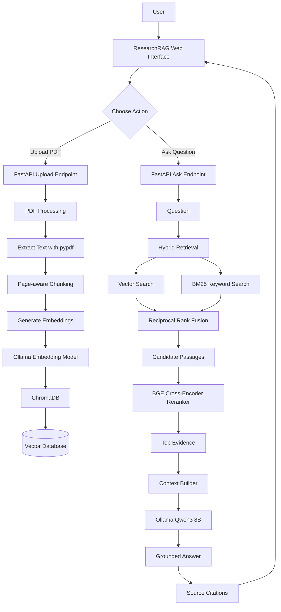
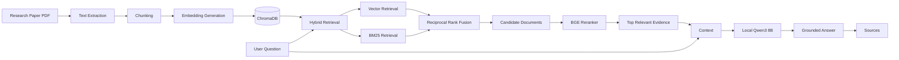
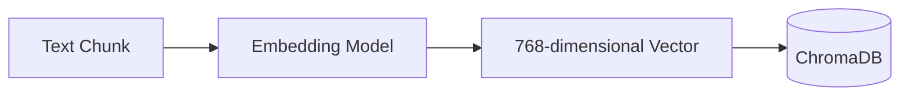
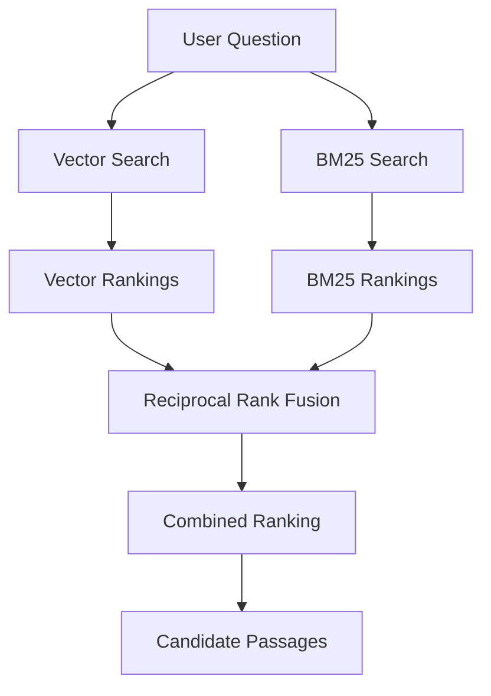
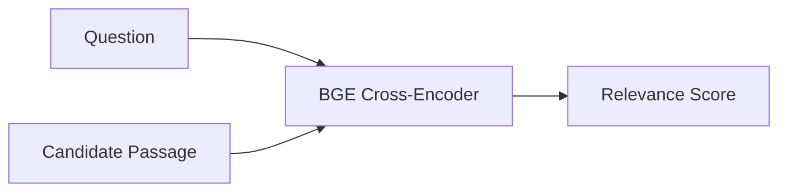
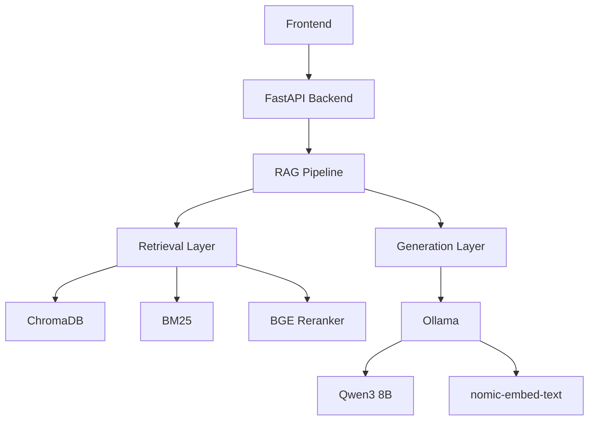
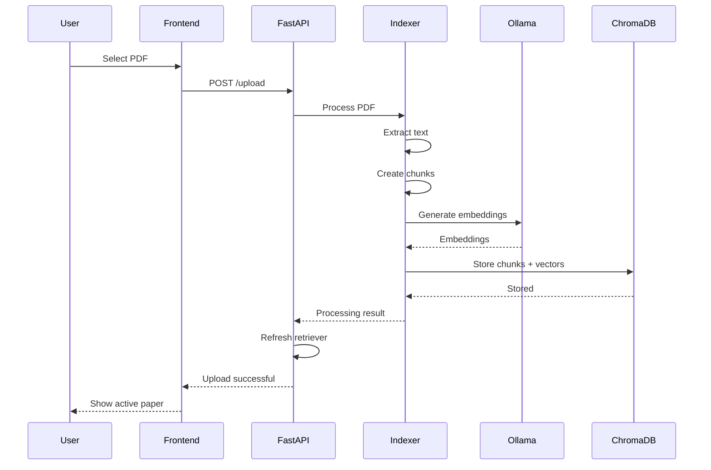
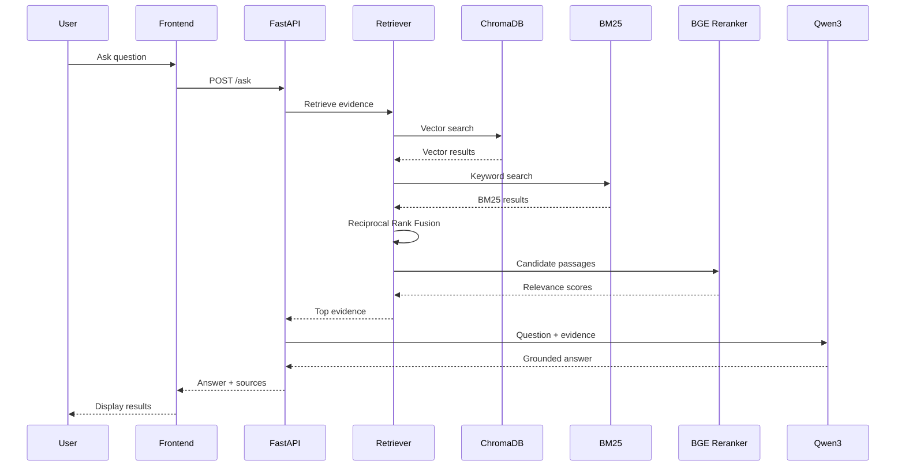
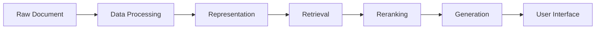
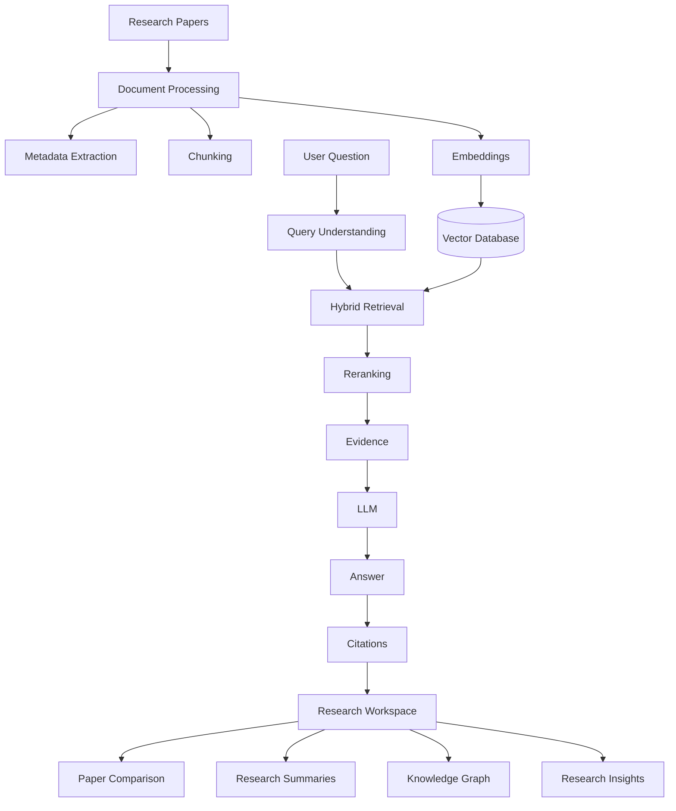

# ResearchRAG

> **A local, domain-specific Retrieval-Augmented Generation (RAG) system for asking questions about AI/ML research papers.**

ResearchRAG is a production-oriented local RAG application that allows users to upload an AI/ML research paper, index its contents, retrieve relevant evidence using multiple retrieval strategies, rerank the retrieved passages, and generate grounded answers using a locally running language model.

The entire system runs locally using **Ollama**, allowing the application to perform embeddings and answer generation without relying on paid cloud LLM APIs.

---

## ✨ Overview

Research papers can contain dozens of pages of dense technical information, making it difficult to quickly locate specific concepts, methods, experiments, and conclusions.

ResearchRAG solves this problem by turning a research paper into a searchable knowledge base.

Instead of asking a language model to answer a question from its general knowledge, ResearchRAG:

1. Accepts a research paper as a PDF.
2. Extracts its text page-by-page.
3. Splits the text into smaller chunks.
4. Converts those chunks into vector embeddings.
5. Stores the embeddings in ChromaDB.
6. Searches the paper using semantic vector retrieval.
7. Searches the paper using BM25 keyword retrieval.
8. Combines both retrieval strategies using Reciprocal Rank Fusion.
9. Reranks the candidate passages using a BGE cross-encoder.
10. Sends the strongest evidence to a local LLM.
11. Generates an answer grounded in the retrieved evidence.
12. Displays the answer together with source pages.

The result is a local research assistant that can answer questions about the currently uploaded paper while showing where the information came from.

---

# 🎯 Project Goals

ResearchRAG was designed around several goals:

- Build a complete end-to-end RAG system.
- Keep the system local and privacy-friendly.
- Avoid dependence on paid LLM APIs.
- Combine semantic and keyword retrieval.
- Improve retrieval quality using reranking.
- Preserve page-level source information.
- Provide evidence-backed answers.
- Create a clean API and frontend architecture.
- Build something that can be extended into a larger research assistant.

---

# 🧠 What is RAG?

**RAG stands for Retrieval-Augmented Generation.**

A normal LLM answers a question primarily from knowledge encoded inside its model parameters.

A RAG system works differently.

Instead of asking:

```text
Question
   ↓
LLM
   ↓
Answer
```

ResearchRAG uses:

```text
Question
   ↓
Retrieve relevant information
   ↓
Give retrieved information to LLM
   ↓
Generate grounded answer
```

This allows the model to answer questions using the contents of a specific document rather than relying only on its pretrained knowledge.

---

# 🏗️ System Architecture

The overall ResearchRAG architecture can be represented as:



---

# 🔄 Complete RAG Pipeline

The complete information flow looks like this:



---

# 📄 1. Document Ingestion

The first stage begins when the user uploads a PDF.

ResearchRAG currently supports PDF research papers.

The backend receives the uploaded file through:

```text
POST /upload
```

The uploaded document becomes the **active research paper**.

The previous paper and its stored embeddings are removed so that questions are answered against the currently uploaded paper rather than mixing multiple papers together.

---

# 🔍 2. PDF Text Extraction

The PDF is processed using:

```text
pypdf
```

ResearchRAG reads the document page-by-page.

Each extracted page keeps its page number.

This is important because source information is later displayed to the user.

Conceptually:

```text
PDF
│
├── Page 1
│     └── Extracted text
│
├── Page 2
│     └── Extracted text
│
├── Page 3
│     └── Extracted text
│
└── ...
```

---

# ✂️ 3. Text Chunking

Large research papers cannot efficiently be passed to an LLM as one giant block of text.

Therefore, each page is divided into smaller chunks.

ResearchRAG currently uses:

```text
Chunk size: 600 words
Overlap: 100 words
```

The overlap helps preserve context between neighboring chunks.

For example:

```text
Chunk 1
────────────────────────────
Word 1 → Word 600
────────────────────────────

             ↓ 100-word overlap

Chunk 2
────────────────────────────
Word 501 → Word 1100
────────────────────────────

             ↓ 100-word overlap

Chunk 3
────────────────────────────
Word 1001 → Word 1600
────────────────────────────
```

Each chunk receives metadata such as:

```text
chunk_id
page
source
text
```

Example:

```text
BERT_p9_c1

Source:
BERT.pdf

Page:
9
```

---

# 🧮 4. Embedding Generation

After chunking, each chunk is converted into a numerical representation called an **embedding**.

ResearchRAG uses:

```text
nomic-embed-text
```

through Ollama.

Conceptually:



Instead of storing only the original text, the system stores a numerical representation of the meaning of that text.

For example:

```text
"Transformers use self-attention mechanisms"

                ↓

        Embedding Model

                ↓

[0.021, -0.184, 0.442, ...]
```

The resulting vector can then be compared with the vector representation of a user's question.

---

# 🗄️ 5. ChromaDB

ResearchRAG uses **ChromaDB** as its local vector database.

The database stores:

- embeddings
- document chunks
- chunk IDs
- page numbers
- source filenames

Conceptually:

```text
                    ChromaDB
                       │
        ┌──────────────┼──────────────┐
        │              │              │
     Vector         Document       Metadata
    Embedding         Text        Page / Source
        │              │              │
        └──────────────┼──────────────┘
                       │
                 Searchable Data
```

The Chroma database is stored locally in:

```text
chroma_db/
```

This directory is excluded from Git using `.gitignore`.

---

# 🔎 6. Hybrid Retrieval

One of the important features of ResearchRAG is that it does not rely on only one retrieval method.

It combines:

### Semantic Vector Retrieval

and

### BM25 Keyword Retrieval

This is called **hybrid retrieval**.

---

## Semantic Retrieval

Semantic retrieval tries to understand the meaning of the question.

For example:

```text
Question:
"How does BERT understand context?"

```

A semantic retriever may find passages discussing:

```text
bidirectional representations
contextual word representations
Transformer encoders
self-attention
```

even if the exact phrase "understand context" does not appear.

---

## BM25 Retrieval

BM25 is a traditional keyword-based information retrieval algorithm.

It is useful when exact terminology matters.

For example:

```text
Question:
"What is the masked language model objective?"

```

BM25 can strongly prioritize passages containing terms such as:

```text
masked
language
model
objective
```

---

# 🔀 7. Reciprocal Rank Fusion

The results from vector retrieval and BM25 retrieval are combined using:

**Reciprocal Rank Fusion (RRF).**

Conceptually:



RRF rewards documents that appear highly in multiple retrieval systems.

The basic idea is:

```text
Higher ranking
      ↓
Higher contribution
      ↓
Higher combined score
```

This helps combine the strengths of semantic and lexical retrieval.

---

# 🎯 8. Cross-Encoder Reranking

After hybrid retrieval, ResearchRAG has a smaller set of candidate passages.

These candidates are then reranked using:

```text
BAAI/bge-reranker-base
```

This is a **cross-encoder reranker**.

Unlike embedding-based retrieval, the reranker directly examines the relationship between:

```text
Question
+
Candidate passage
```

Conceptually:



For example:

```text
Question
   +
Passage 1
   ↓
Score: 0.91

Question
   +
Passage 2
   ↓
Score: 0.42

Question
   +
Passage 3
   ↓
Score: 0.78
```

The highest-scoring passages are selected as the final evidence.

---

# 🧠 9. Context Construction

The highest-ranked chunks are converted into structured evidence blocks.

ResearchRAG assigns evidence IDs:

```text
[E1]
[E2]
[E3]
[E4]
[E5]
```

Each evidence block contains:

```text
Evidence ID
Source
Page
Text
```

Example:

```text
[E1]

Source: BERT.pdf
Page: 9

BERT introduces...
```

This gives the generator a clear connection between the answer and its supporting evidence.

---

# 🤖 10. Local LLM Generation

ResearchRAG uses:

```text
Qwen3 8B
```

through:

```text
Ollama
```

The model runs locally rather than using a cloud API.

The LLM receives:

```text
User Question
        +
Retrieved Evidence
        ↓
    Qwen3 8B
        ↓
Generated Answer
```

The prompt instructs the model to:

- use only the supplied evidence
- avoid outside knowledge
- avoid inventing facts
- provide a concise answer
- identify supporting evidence

---

# 📚 11. Evidence-Based Citations

ResearchRAG associates generated answers with retrieved evidence.

For example:

```text
BERT introduced a bidirectional Transformer
representation that allows each token to use
information from both directions. [E1] [E2]
```

The frontend then maps these evidence IDs back to their original source information.

Example:

```text
Sources

[E1] BERT.pdf — Page 9
[E2] BERT.pdf — Page 1
[E3] BERT.pdf — Page 13
```

This makes the generated answer more transparent and easier to verify.

---

# 🖥️ Application Architecture

ResearchRAG is divided into three major layers:



---

# 📁 Project Structure

```text
ResearchRAG/
│
├── api/
│   ├── main.py
│   ├── rag.py
│   ├── retriever.py
│   ├── generator.py
│   └── indexer.py
│
├── src/
│   ├── ingest.py
│   └── vector_store.py
│
├── frontend/
│   ├── index.html
│   ├── style.css
│   └── script.js
│
├── data/
│   └── papers/
│       └── .gitkeep
│
├── chroma_db/
│   └── generated locally
│
├── .gitignore
├── README.md
└── requirements.txt
```

> `chroma_db/` and uploaded research papers are intentionally excluded from version control.

---

# 🔌 API Architecture

ResearchRAG exposes a FastAPI backend.

The main endpoints are:

| Endpoint | Method | Purpose |
|---|---|---|
| `/` | GET | Basic API status |
| `/health` | GET | Health check |
| `/upload` | POST | Upload and process a PDF |
| `/ask` | POST | Ask a question about the active paper |

---

# 📤 Upload Flow

When a user uploads a paper:



---

# ❓ Question Answering Flow

When the user asks a question:



---

# 🔐 Local-First Architecture

A major design decision in ResearchRAG is keeping the AI pipeline local.

Instead of:

```text
Your Computer
      ↓
Internet
      ↓
Cloud LLM API
      ↓
Answer
```

ResearchRAG uses:

```text
Your Computer
      │
      ├── FastAPI
      │
      ├── ChromaDB
      │
      └── Ollama
            │
            ├── Embedding Model
            │
            └── Qwen3 8B
```

This means the core document processing, retrieval, embeddings, and generation can operate locally.

---

# 🧰 Technology Stack

## Backend

- Python
- FastAPI
- Uvicorn
- Pydantic

## Document Processing

- pypdf

## Retrieval

- ChromaDB
- BM25
- rank-bm25
- Reciprocal Rank Fusion

## Reranking

- Sentence Transformers
- `BAAI/bge-reranker-base`

## Local AI

- Ollama
- Qwen3 8B
- nomic-embed-text

## Frontend

- HTML
- CSS
- JavaScript

---

# 🚀 Running ResearchRAG Locally

## 1. Start Ollama

Make sure Ollama is running on your computer.

Verify the installed models with:

```powershell
ollama list
```

The project expects:

```text
qwen3:8b
nomic-embed-text
```

and uses:

```text
BAAI/bge-reranker-base
```

for reranking.

---

# 2. Start the Backend

From the project root:

```powershell
uvicorn api.main:app --reload
```

The API runs at:

```text
http://127.0.0.1:8000
```

---

# 3. Start the Frontend

Open another terminal and run:

```powershell
python -m http.server 5500 --directory frontend
```

Then open:

```text
http://127.0.0.1:5500
```

---

# 🧪 Example Workflow

A typical ResearchRAG session looks like:

```text
1. Start Ollama
        ↓
2. Start FastAPI
        ↓
3. Start frontend
        ↓
4. Open ResearchRAG
        ↓
5. Upload research paper
        ↓
6. Wait for processing
        ↓
7. Ask a question
        ↓
8. Hybrid retrieval
        ↓
9. Reranking
        ↓
10. Local LLM generation
        ↓
11. View answer
        ↓
12. Verify source pages
```

---

# 💡 Example

Suppose the uploaded paper is:

```text
BERT: Pre-training of Deep Bidirectional Transformers
for Language Understanding
```

The user asks:

```text
What is the main contribution of BERT?
```

ResearchRAG performs:

```text
Question
   ↓
Embedding
   ↓
Vector Search
   +
BM25 Search
   ↓
RRF
   ↓
BGE Reranking
   ↓
Top Evidence
   ↓
Qwen3 8B
   ↓
Answer
   ↓
Source Pages
```

The user receives a concise answer together with the relevant sections of the uploaded paper.

---

# 📈 Why Hybrid Retrieval?

A single retrieval technique can have weaknesses.

| Retrieval Method | Strength |
|---|---|
| Vector Search | Understands semantic similarity |
| BM25 | Excellent for exact terminology |
| RRF | Combines different ranking signals |
| Cross-Encoder | Performs deeper query-document relevance scoring |

ResearchRAG combines these stages into a retrieval pipeline:

```text
Vector Search
      +
BM25
      ↓
RRF
      ↓
Candidate Set
      ↓
BGE Cross-Encoder
      ↓
Final Evidence
```

---

# 🧩 Design Decisions

## Why Ollama?

Ollama allows local models to be run without requiring a paid hosted LLM API.

This makes experimentation easier and allows the project to remain local-first.

---

## Why ChromaDB?

ChromaDB provides a simple local vector database that is well suited for experimenting with embedding-based retrieval.

It allows ResearchRAG to store and query document embeddings without requiring a separate cloud database.

---

## Why BM25?

Semantic search is powerful, but exact technical terminology matters heavily in research papers.

BM25 provides a complementary keyword-based retrieval signal.

---

## Why Reranking?

Initial retrieval is designed to quickly find plausible candidates.

Reranking then performs a more detailed relevance comparison on a smaller candidate set.

This creates a two-stage retrieval architecture:

```text
Fast Retrieval
      ↓
Candidate Documents
      ↓
More Accurate Reranking
      ↓
Best Evidence
```

---

# 📊 Current Retrieval Pipeline

The current implementation uses:

```text
                User Question
                      │
          ┌───────────┴───────────┐
          │                       │
          ▼                       ▼
     Vector Search             BM25
          │                       │
          └───────────┬───────────┘
                      ▼
               RRF Combination
                      │
                      ▼
             Candidate Passages
                      │
                      ▼
              BGE Reranker
                      │
                      ▼
               Top 5 Evidence
                      │
                      ▼
                Qwen3 8B
                      │
                      ▼
              Grounded Answer
                      │
                      ▼
                  Sources
```

---

# 🛡️ Grounding Strategy

One of the important goals of ResearchRAG is reducing unsupported answers.

The generator is explicitly instructed to use the retrieved evidence rather than relying on external knowledge.

The conceptual rule is:

```text
If the evidence supports the answer:
        → Answer using the evidence

If the evidence does not support the answer:
        → Do not invent information
```

This is particularly important for research-paper question answering.

---

# 🧠 Key Concepts Demonstrated

This project demonstrates practical implementation of:

- Large Language Models
- Retrieval-Augmented Generation
- Vector embeddings
- Vector databases
- Semantic search
- Keyword search
- BM25
- Reciprocal Rank Fusion
- Cross-encoder reranking
- Local LLM inference
- Document chunking
- Metadata handling
- Source attribution
- REST APIs
- FastAPI
- Frontend-backend integration
- PDF processing
- Local AI infrastructure

---

# 📚 What I Learned Building This

Building ResearchRAG provides hands-on experience with the complete lifecycle of an AI application:



Rather than treating an LLM as a standalone chatbot, the project demonstrates how modern AI systems combine:

```text
Data
+
Retrieval
+
Models
+
APIs
+
Software Engineering
```

---

# 🔮 Future Improvements

Possible future improvements include:

### Multi-document collections

Allow users to maintain multiple papers simultaneously rather than using one active paper.

### Better chunking

Experiment with semantic or structure-aware chunking instead of fixed word windows.

### Metadata filtering

Allow retrieval by:

- author
- year
- paper
- section
- page

### More document formats

Potential support for:

```text
PDF
DOCX
Markdown
HTML
```

### Advanced citation handling

Improve citation mapping so generated statements can be linked directly to exact source passages.

### Evaluation

Introduce a formal retrieval and generation evaluation pipeline using metrics such as:

- Recall@K
- Precision@K
- MRR
- NDCG
- answer faithfulness

### Research assistant features

Potential future features include:

```text
Paper Summarization
       +
Question Answering
       +
Paper Comparison
       +
Literature Search
       +
Research Gap Detection
       +
Citation Exploration
```

---

# 🗺️ Future Architecture

The long-term direction could evolve toward:



---

# ⚙️ Project Status

Current implementation:

| Feature | Status |
|---|---|
| PDF upload | ✅ |
| PDF text extraction | ✅ |
| Page-aware chunking | ✅ |
| Local embeddings | ✅ |
| ChromaDB vector storage | ✅ |
| Semantic retrieval | ✅ |
| BM25 retrieval | ✅ |
| Reciprocal Rank Fusion | ✅ |
| BGE reranking | ✅ |
| Local Qwen3 generation | ✅ |
| Evidence-based answers | ✅ |
| Source pages | ✅ |
| FastAPI backend | ✅ |
| Web interface | ✅ |
| Local-first operation | ✅ |
| GitHub-ready structure | ✅ |

---

# 📌 Limitations

ResearchRAG is currently optimized for text-based research PDFs.

It may not correctly understand:

- scanned PDFs without a text layer
- complex mathematical equations
- images
- charts
- tables
- diagrams
- handwritten content
- highly complex PDF layouts

The quality of the final answer also depends on:

- PDF text extraction quality
- chunking strategy
- retrieval quality
- reranking quality
- LLM behavior

---

# 🔒 Privacy

ResearchRAG is designed around local processing.

The core AI pipeline uses:

```text
Local PDF
     ↓
Local Processing
     ↓
Local Embeddings
     ↓
Local Vector Database
     ↓
Local Retrieval
     ↓
Local LLM
```

No cloud LLM API is required for the core RAG workflow.

---

# 👩‍💻 Author

Built as a hands-on AI/ML engineering project focused on understanding how modern Retrieval-Augmented Generation systems work internally.

The goal was not simply to call an LLM API, but to understand and implement the complete pipeline:

```text
Documents
   ↓
Chunking
   ↓
Embeddings
   ↓
Vector Database
   ↓
Retrieval
   ↓
Reranking
   ↓
Context
   ↓
LLM
   ↓
Grounded Answer
```

---

# ⭐ Final Takeaway

ResearchRAG demonstrates how a local research assistant can be built by combining traditional information retrieval, modern neural retrieval, reranking models, vector databases, and local language models.

The central idea is simple:

> **Retrieve the right evidence first. Then ask the language model to reason over that evidence.**

That separation between **retrieval** and **generation** is the foundation of the system.

---

## 🏁 ResearchRAG

**Upload a paper.  
Ask a question.  
Retrieve the evidence.  
Generate the answer.  
Verify the source.**